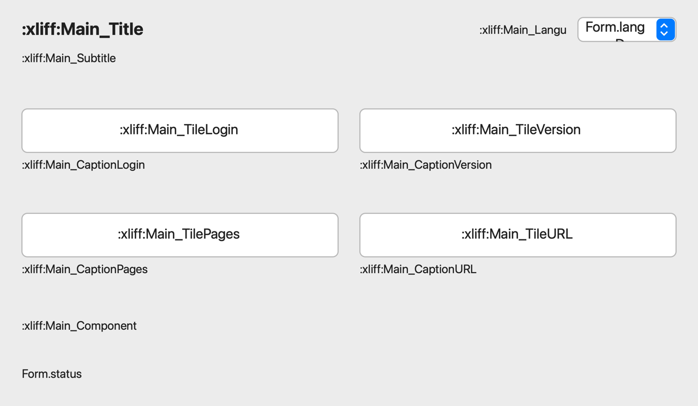
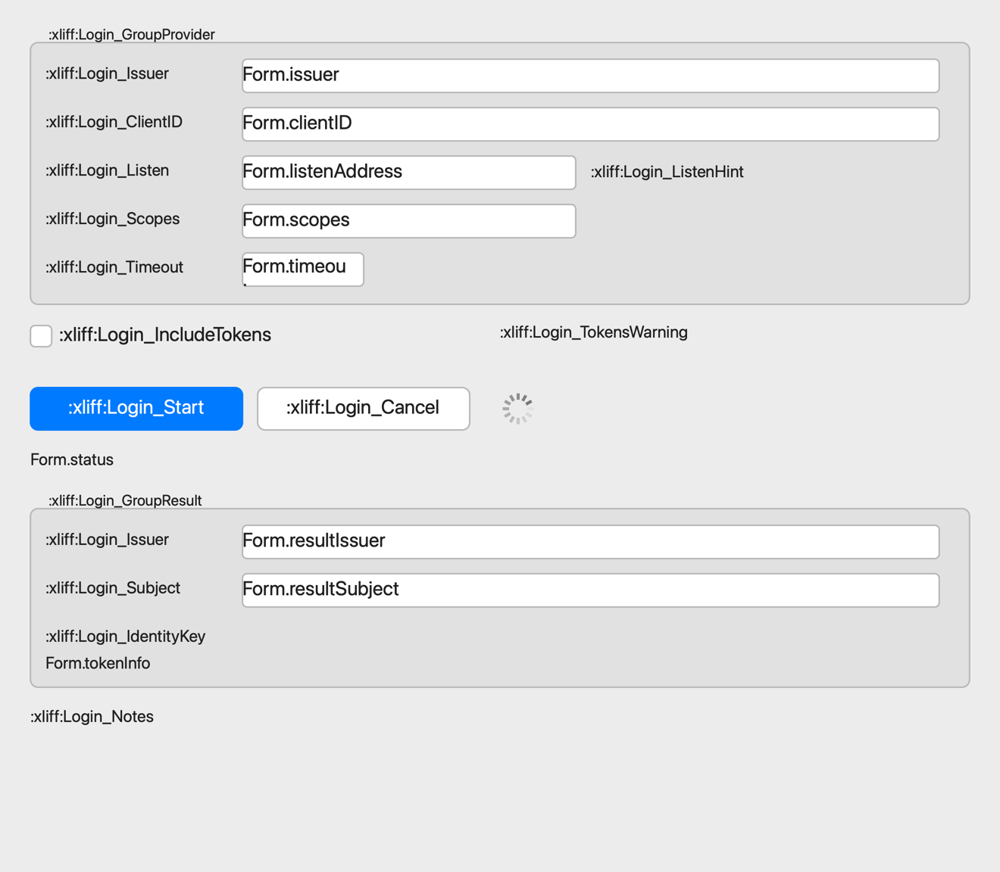
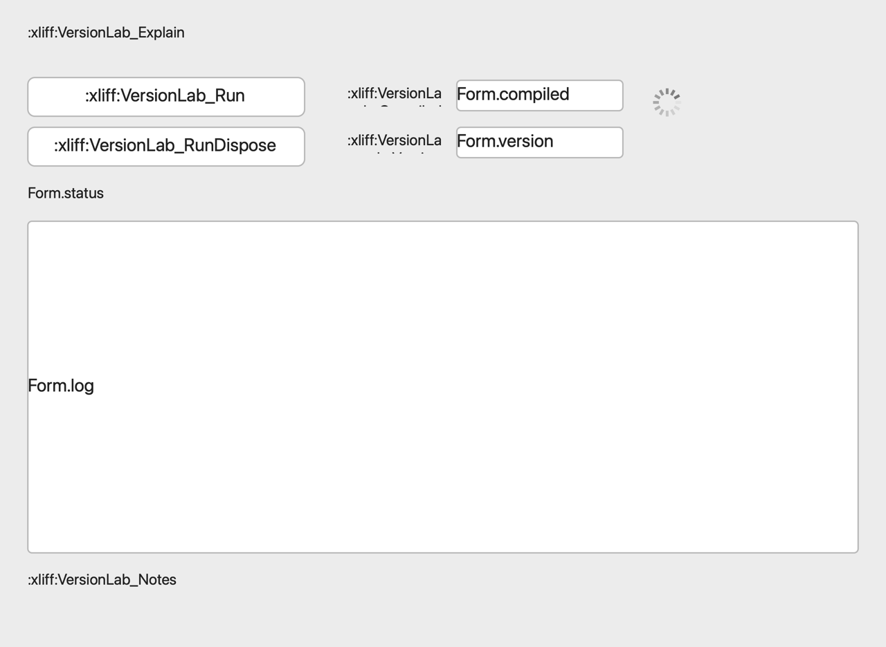
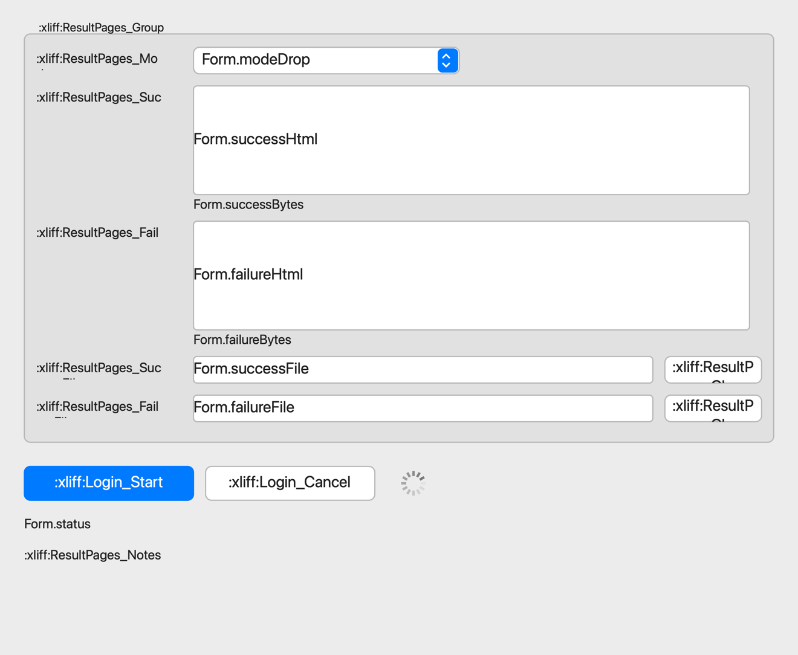
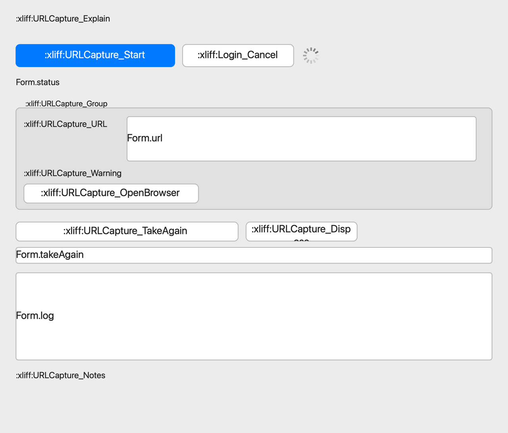

# openid-demo


[日本語](#日本語) | [English](#english)

---

## 日本語

[miyako/openid](https://github.com/miyako/openid) 4D コンポーネント（名前空間 `OpenID`、クラス `Client` / `Task`）を使ったインタラクティブなデモです。4 つの「ラボ」画面で、非同期の OpenID Connect 認証と Task ライフサイクルを実際に操作しながら確認できます。データファイルは不要で、ローカルのループバックリスナーだけで動作します。

### このデモでわかること

- `cs.OpenID.Client.new()` と `authenticate()` による非同期認証。PKCE 付きで、ローカルのループバックコールバック（`127.0.0.1:42813`）を使います。
- `authenticate()` / `version()` が即座に `Task` を返すノンブロッキング設計。フォームは `On Timer` で `.done` をポーリングします。
- `Task.cancel()` / `Task.dispose()` の挙動。完了前に `dispose()` すると結果が破棄されることを、実際に試せます。
- `takeAuthorizationURL()` による認可 URL の取得。読み取りとクリアが同時に行われることも確認できます。
- 識別情報は `(issuer, subject)`。4D Server のログインではありません。
- アプリ内での日本語/英語切り替え（`SET DATABASE LOCALIZATION` + 再起動パターン）。

### はじめかた

1. このリポジトリをクローンし、`Project/openid-demo.4DProject` を 4D 21.1 LTS で開きます。初回オープン時に Dependency manager が `miyako/openid` `0.1.3` を取得します（ネットワークが必要です）。
2. 起動するとハブウィンドウが開きます。メニューバーの「ラボ」からも各画面を開けます。
3. Auth0 テナントを自分で用意してください: ネイティブアプリケーションを作成し、コールバック `http://127.0.0.1:42813/callback` を登録します。Issuer と Client ID をログインラボに入力します。シークレットは保存・記録しません。

### デモの進めかた

- **ログインラボ** — Issuer と Client ID を入力して「ログイン開始」。ブラウザが開き、同意後に識別情報（issuer, subject）が表示されます。「結果にトークンを含める」を有効にすると、トークンの値ではなく形式（長さと期限）だけが表示されます。実行中はいつでもキャンセルできます。
- **バージョンラボ** — `version()` は設定不要で即座に Task を返します（Apple Silicon / tool4d 21 R5 のインタープリタ実行で約 500 ミリ秒を計測）。「呼び出して dispose()」を実行すると、完了前の `dispose()` が結果を破棄することを確認できます。
- **結果ページラボ** — モードを「インライン HTML」または「HTML ファイル」に切り替え、成功/失敗ページを編集します。UTF-8 バイト数カウンタ（上限 65536）が随時更新されます。この状態でログインすると、自分のページが表示されます。
- **URLラボ** — ブラウザを開かずに認証を開始し、`takeAuthorizationURL()` で URL を取得して自分で開きます。完了後にもう一度呼び出すと空が返ります。
- ハブの言語ドロップダウンで、その場で日本語/英語を切り替えられます。

### しくみ

`Start` がハブ（`Main` フォーム）を開き、各ラボは `OpenDemoForm` が `DIALOG` で開く独立ウィンドウです。ログインの流れは `Demo_StartLogin` が `Demo_BuildConfig` で設定を組み立て、`cs.OpenID.Client.new($config; Demo_TargetPlatform()).authenticate()` を呼びます。戻り値の Task はフォームが所有し、`Demo_PollTask` が `On Timer` で完了を待ち、`result()` を読んでから `dispose()` します。キャンセルは `Task.cancel()` 経由で、ワーカーは決して強制終了しません。

### References

- [miyako/openid](https://github.com/miyako/openid) — README, `Documentation/Classes/Client.md`, `Documentation/Classes/Task.md`
- 4D ドキュメント: [Localized string](https://developer.4d.com/docs/commands/localized-string), [SET DATABASE LOCALIZATION](https://developer.4d.com/docs/commands/set-database-localization), [DIALOG](https://developer.4d.com/docs/commands/dialog), [FORM Event](https://developer.4d.com/docs/commands/form-event)

### スクリーンショット

| | |
|---|---|
|  |  |
|  |  |
|  | |

---

## English

An interactive demo for the [miyako/openid](https://github.com/miyako/openid)
4D component (namespace `OpenID`, classes `Client` / `Task`). Four "lab"
windows let you operate asynchronous OpenID Connect authentication and the
Task lifecycle hands-on. No data file is needed; everything runs against a
local loopback listener.

### What it demonstrates

- Asynchronous authentication with `cs.OpenID.Client.new()` and
  `authenticate()`, using PKCE and a local loopback callback
  (`127.0.0.1:42813`).
- The nonblocking design: `authenticate()` / `version()` return a `Task`
  immediately; forms poll `.done` from `On Timer`.
- `Task.cancel()` / `Task.dispose()` behaviour -- including the fact that
  `dispose()` before completion discards the result, which you can trigger
  yourself.
- Fetching the authorization URL with `takeAuthorizationURL()`, and its
  read-and-clear semantics.
- The identity key `(issuer, subject)` -- not a 4D Server login.
- An in-app English/Japanese switch (`SET DATABASE LOCALIZATION` plus the
  restart pattern).

### Requirements

- 4D 21.1 LTS or later (macOS universal or Windows x64).
- Network on first open: the Dependency manager fetches `miyako/openid`
  `0.1.3` from GitHub Releases. The component bundles the pinned external
  CLI; roughly 25 MB of disk.
- Network during login (provider endpoints and JWKS).
- No data file: the project runs dataless.
- Your own Auth0 tenant: create a native application and register the
  callback `http://127.0.0.1:42813/callback`. No secret is stored, logged
  or persisted anywhere in this repository.

### Getting started

1. Clone the repository and open `Project/openid-demo.4DProject` in 4D.
2. The hub window opens on startup; the "Labs" menu opens the same windows.
3. Enter your issuer and client ID in the Login lab.

### Running the demo

- **Login lab** -- enter issuer and client ID, press "Start login". The
  browser opens; after consent the verified identity (issuer, subject)
  appears. Tick "Include tokens in result" to see token shape only
  (lengths and expiry, never values). Cancel works at any time.
- **Version lab** -- `version()` needs no configuration and returns
  immediately (measured at about 500 ms interpreted on Apple Silicon with
  tool4d 21 R5). "Call version() then dispose()" shows a discarded result.
- **Result pages lab** -- switch the mode to inline HTML or HTML files,
  edit the pages, watch the UTF-8 byte counter (65536 limit), then start a
  login to see your own pages served after identity verification.
- **URL lab** -- start without a browser, take the authorization URL from
  memory, open it yourself; after completion the second
  `takeAuthorizationURL()` returns empty.
- The language dropdown on the hub switches English/Japanese in place.

### How it works

`Start` opens the hub (`Main`); each lab is a separate window opened by
`OpenDemoForm` with `DIALOG`. For a login, `Demo_StartLogin` assembles the
configuration in `Demo_BuildConfig` and calls
`cs.OpenID.Client.new($config; Demo_TargetPlatform()).authenticate()`. The
form owns the returned Task; `Demo_PollTask` waits on `On Timer`, reads
`result()` and only then calls `dispose()`. Cancellation always goes
through `Task.cancel()`; the worker is never killed.

### Points of interest

- `Demo_PollTask.4dm` -- the read-before-dispose contract, plus the
  shape-only token display.
- `VersionLab/ObjectMethods/btnRunDispose.4dm` -- disposal before
  completion, and what the poll then reports.
- `URLCapture/ObjectMethods/btnTakeAgain.4dm` -- read-and-clear semantics.
- `SwitchLanguage.4dm` -- the verified in-app language switch
  (`SET DATABASE LOCALIZATION` + `CANCEL` + `CALL WORKER(1; ...)`).

### Headless check

`Demo_HeadlessSelfTest` proves the declared dependency loads and a real
`version()` task completes without any UI:

```sh
tool4d Project/openid-demo.4DProject --startup-method Demo_HeadlessSelfTest --dataless
```

The JSON report lands next to the repository root
(`openid-demo-selftest.json`, gitignored).

### References

- [miyako/openid](https://github.com/miyako/openid) -- README,
  `Documentation/Classes/Client.md`, `Documentation/Classes/Task.md`
- 4D documentation: [Localized string](https://developer.4d.com/docs/commands/localized-string),
  [SET DATABASE LOCALIZATION](https://developer.4d.com/docs/commands/set-database-localization),
  [DIALOG](https://developer.4d.com/docs/commands/dialog),
  [FORM Event](https://developer.4d.com/docs/commands/form-event)

### Screenshots

| | |
|---|---|
|  |  |
|  |  |
|  | |
